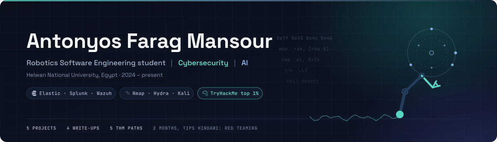
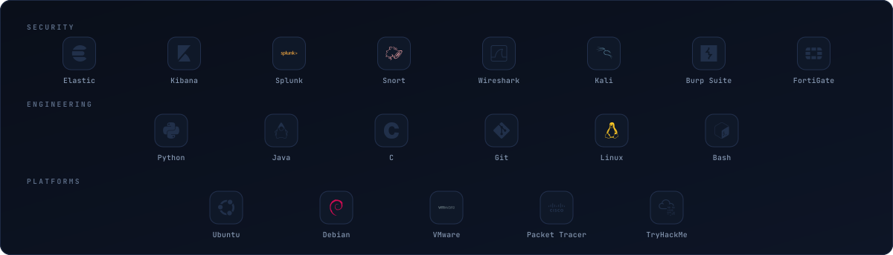
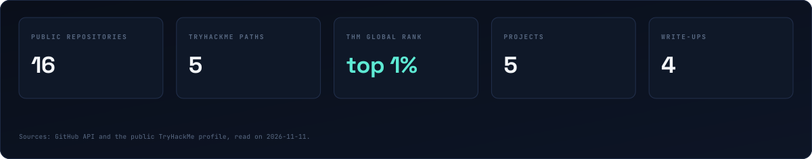
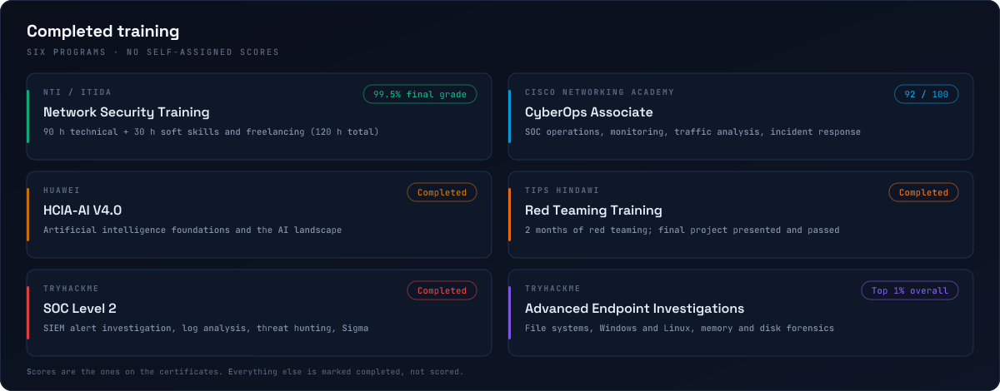
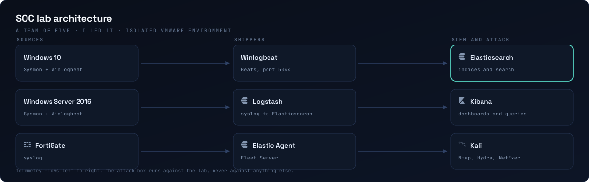
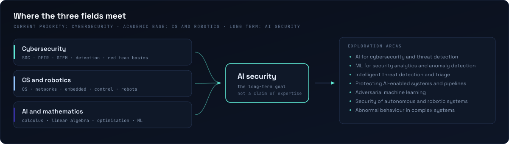
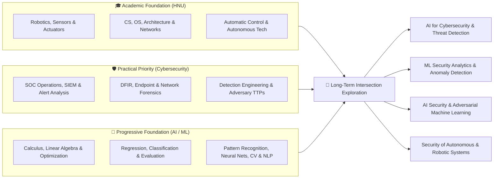

<div align="center">

<picture>
  <source media="(max-width: 600px) and (prefers-color-scheme: dark)" srcset="./assets/hero-narrow-dark.svg" />
  <source media="(max-width: 600px) and (prefers-color-scheme: light)" srcset="./assets/hero-narrow-light.svg" />
  <source media="(prefers-color-scheme: dark)" srcset="./assets/hero-dark.svg" />
  <source media="(prefers-color-scheme: light)" srcset="./assets/hero-light.svg" />
  
</picture>

<br />

<!-- Quick links: one row, one colour family, no emoji -->

[](https://www.linkedin.com/in/antonyos-farag-9560b6341)
[](https://github.com/Antonyos-Farag)
[](https://tryhackme.com/p/AntonyosFarag)
[](mailto:antonyosfarag6@gmail.com)

</div>

---

## About

I am a Computer Science & IT student at **Helwan National University**, specializing in **Robotics Software Engineering**, since 2024. Most of my practical work is on the defensive side of security — SOC operations, SIEM, log analysis and endpoint investigation — and I am building the mathematical foundations of machine learning alongside it.

I like systems where the hard part is understanding what is actually happening: a log pipeline that silently drops events, a search algorithm that wins one ply earlier, a robot arm that overshoots. The current goal is an internship in **SOC / defensive security**, **AI/ML**, or **robotics software**, on-site or remote.

I do not publish scores I did not receive, ratings I cannot verify, or work I did not do. Where a project was a team effort, the card says so and says which part was mine.

### What I'm into

| **Robotics Software** | **Cybersecurity** | **AI & Machine Learning** |
| :-: | :-: | :-: |
| Control, sensors, embedded systems, and the software that sits between a model of the world and a motor. | SOC operations, SIEM pipelines, log analysis, endpoint forensics, detection engineering — the defender's side, with enough offensive practice to know what is being defended against. | Regression to neural networks, with the calculus and linear algebra underneath them rather than a library call on top. |

---

## Featured Projects

<table>
<tr>
<td width="50%" valign="top">

### Elastic SIEM Lab

Ubuntu-hosted Elastic Stack collecting Windows (Sysmon + Winlogbeat) and FortiGate (syslog via Logstash) telemetry, with Nmap and Hydra exercises run from Kali in an isolated lab.

`Elasticsearch` `Kibana` `Logstash` `Sysmon` `FortiGate` `Kali`

**Team of 5 — I led it** and presented the result to doctors and instructors.

[**Repository →**](https://github.com/Antonyos-Farag/Elastic-SIEM-Network-Security-Monitoring-Lab)

</td>
<td width="50%" valign="top">

### ChessBot

A chess engine with a browser app and a tkinter desktop app: iterative deepening, principal variation search, transposition table, quiescence search, tapered evaluation, an opening book of 3,844 ECO lines, and 57 tests.

`Python` `Alpha-beta` `python-chess` `WebSocket` `tkinter`

**Forked from [XxPhotonguyxX/ChessBot](https://github.com/XxPhotonguyxX/ChessBot)**, worked on as a team. **My part: alpha-beta pruning and the GUI.**

[**Repository →**](https://github.com/Antonyos-Farag/ChessBot)

</td>
</tr>
<tr>
<td width="50%" valign="top">

### Bug Tracker System

Role-based desktop bug tracker for Tester, Developer, Project Manager and Admin, with a JavaFX interface and a console client over shared services.

`Java 17` `JavaFX 21` `Maven` `SMTP`

**Team course project. My part: the services and backend layer.**

[**Repository →**](https://github.com/Antonyos-Farag/Bug_tracker_system)

</td>
<td width="50%" valign="top">

### SRTF CPU Scheduler

Shortest-Remaining-Time-First simulator that prints a Gantt chart plus waiting, turnaround and response times, with an example set and a unittest suite.

`Python 3.8+` `Scheduling` `unittest` `MIT`

**Team course project. My part: the scheduling algorithm.**

[**Repository →**](https://github.com/Antonyos-Farag/simple-CPU-scheduling-simulator-for-SRTF-Shortest-Remaining-Time-First-)

</td>
</tr>
<tr>
<td width="50%" valign="top">

### Linux Terminal E-Commerce System

A role-based menu for Admin, Seller and Customer that wraps Linux shell commands, in two builds: the original and an ANSI-themed one.

`C` `Makefile` `Linux`

**Team course project. My part: documentation and the build.**

[**Repository →**](https://github.com/Antonyos-Farag/Linux-Terminal-E-Commerce-System-)

</td>
<td width="50%" valign="top">

### Also worth a look

- **Cisco Packet Tracer network design** — 24 endpoints across VLANs.
- **Debian home server** — self-hosted services on hardware I maintain.
- **The AI context block** in this repository, written so assistants stop guessing about my background.

[**All repositories →**](https://github.com/Antonyos-Farag?tab=repositories)

</td>
</tr>
</table>

---

## Write-ups

Four TryHackMe rooms written up with the reasoning, the queries and the evidence, not just the answers:

| Room | Focus | Write-up |
| :--- | :--- | ---: |
| **Investigating with Splunk** | Splunk 8.2.6, SPL, nine investigative questions | [Repository&nbsp;→](https://github.com/Antonyos-Farag/Investigating-with-Splunk-THM-write-up) |
| **Benign** | SOC Level 1: Event ID 4688, two Sigma rules, three SPL detections, IOCs | [Repository&nbsp;→](https://github.com/Antonyos-Farag/Benign_THM_write-up) |
| **Phishing — Phishmas Greetings** | Advent of Cyber 2025, Day 12: manual triage of six emails | [Repository&nbsp;→](https://github.com/Antonyos-Farag/Phishing---Phishmas-Greetings-write-up) |
| **Phishing — Merry Clickmas** | Advent of Cyber 2025, Day 2: lookalike login page, captured password reused on a mailbox | [Repository&nbsp;→](https://github.com/Antonyos-Farag/Phishing---Merry-Clickmas-write-up) |

Two templates keep them consistent: a [TryHackMe write-up template](./templates/tryhackme-writeup-template.md) and a [SOC lab experiment template](./templates/soc-lab-experiment-template.md).

---

## Skills

Tools I have actually used in a lab, a project or a room. No proficiency bars, because they would be guesses.

<div align="center">

<picture>
  <source media="(prefers-color-scheme: dark)" srcset="./assets/skills-dark.svg" />
  <source media="(prefers-color-scheme: light)" srcset="./assets/skills-light.svg" />
  
</picture>

</div>

**Security** — Elastic Stack (Elasticsearch, Kibana, Elastic Agent, Fleet, Fleet Server), Splunk, Wazuh, Wireshark, Snort, Zeek, Sysmon, Winlogbeat, FortiGate, Sigma, MITRE ATT&CK, Nmap, Burp Suite, SQLMap, Hydra, Gobuster, Volatility, Kali Linux.
**Engineering** — Python, Java, C, Git, Linux and Windows Server administration, VMware, Cisco Packet Tracer.

---

## Certifications & Training

| Provider | Program | Status |
| :--- | :--- | :--- |
| **NTI / ITIDA** | Network Security — 90 h technical + 30 h soft skills & freelancing | **Completed — 99.5%** |
| **Cisco Networking Academy** | CyberOps Associate | **Completed — 92/100** |
| **Huawei** | HCIA-AI V4.0 | **Completed** |
| **TIPS Hindawi** | TIPS Hindawi: Red Teaming Training — 2 months, final project presented and passed | **Completed** |
| **TryHackMe** | Pre Security | **Completed** |
| **TryHackMe** | Cyber Security 101 | **Completed** |
| **TryHackMe** | SOC Level 1 | **Completed** |
| **TryHackMe** | SOC Level 2 | **Completed** |
| **TryHackMe** | Advanced Endpoint Investigations | **Completed** |
| **DeepLearning.AI / Stanford Online** | Supervised Machine Learning: Regression and Classification | **Completed** |
| **DeepLearning.AI / Stanford Online** | Calculus for Machine Learning and Data Science | **Completed** |
| **DataCamp** | Python — Beginner and Intermediate | **Completed** |

Verification links for the Cisco, NTI, Huawei and DeepLearning.AI credentials are not published yet. When they are, they will be added here rather than replaced with a badge that claims more than the certificate does.

---

## A Few Honest Numbers

<div align="center">

<picture>
  <source media="(prefers-color-scheme: dark)" srcset="./assets/stats-dark.svg" />
  <source media="(prefers-color-scheme: light)" srcset="./assets/stats-light.svg" />
  
</picture>

</div>

The GitHub card is drawn from a local SVG on purpose: no third-party widget can fail here, because there is no third-party widget.

---

## The Long Version

### ⚡ Quick Profile Snapshot

| 🧭 Dimension | 📌 Current Status & Details | 🏷️ Stage |
| :--- | :--- | :---: |
| **🎓 Academic Program** | Undergraduate in **Computer Science & Information Technology** at **Helwan National University (Egypt)** — specializing in **Robotics Software Engineering**, 2024 to present | Ongoing degree |
| **🛡️ Primary Career Focus** | **Cybersecurity** — SOC Operations, SOC Analyst/Engineer, Threat Hunting, Incident Response, DFIR, Detection Engineering | Primary direction |
| **🏅 Completed Training** | **NTI/ITIDA Network Security (99.5%)** · **Cisco CyberOps Associate (92/100)** · **Huawei HCIA-AI V4.0** · **TIPS Hindawi: Red Teaming Training** · **TryHackMe Pre Security, Cyber Security 101, SOC Level 1, SOC Level 2, Advanced Endpoint Investigations** · **DeepLearning.AI / Stanford Online ML and Calculus courses** · **DataCamp Python** | Completed |
| **🖧 Hands-On SOC Lab** | Multi-node lab: **Ubuntu Elastic Stack (Elasticsearch, Kibana, Fleet/Fleet Server)** + **Windows Server & Endpoints** + **Sysmon & Winlogbeat** + **FortiGate** — team of five, led by me | Active practice |
| **📐 AI & ML Approach** | Progressive mathematical & algorithmic foundations (**Calculus, Linear Algebra, Optimization, Gradient Descent, Regression, Classification, Neural Networks**) | Building foundations |
| **🚀 Long-Term Horizon** | **AI Security**, ML for Security Analytics & Anomaly Detection, Adversarial ML, and Security of Autonomous & Robotic Systems | Future exploration |

The ten sections below are the original profile, kept in full and updated. They cover coursework, the security focus, every training program, the lab topology, the AI/ML approach, the intersection of the three fields, professional direction, learning style and the operating rules for any AI assistant working on my material.

<details>
<summary><b>1. 🎓 Academic Background</b></summary>

I am an undergraduate student in **Computer Science and Information Technology at Helwan National University (HNU) in Egypt**, specializing in **Robotics Software Engineering**. My academic background combines computer science, robotics, intelligent systems, automation, and artificial intelligence.

### 🏛️ University Coursework & Technical Subjects Matrix

| 🧩 Domain Category | 📖 University Subjects Covered | 🔗 Cross-Domain Connection |
| :--- | :--- | :--- |
| **🧠 Artificial Intelligence & Learning** | • Artificial Intelligence (AI)<br/>• Machine Learning (ML)<br/>• Pattern Recognition<br/>• Neural Networks | Mathematical modeling, pattern analysis, and feature representation |
| **👁️ Perception & Language Systems** | • Computer Vision<br/>• Natural Language Processing (NLP)<br/>• Speech Processing | Sensor/signal interpretation, unstructured data processing, and intelligent interfaces |
| **💻 Core Computer Science** | • Algorithms and problem-solving<br/>• Operating Systems<br/>• Parallel Processing | Process/memory internals, execution efficiency, and OS-level forensic foundations |
| **⚙️ Architecture & Embedded Systems** | • Computer Architecture and Microprocessors<br/>• Embedded Systems and Real-Time Systems | Low-level hardware behavior, firmware/microprocessor logic, and deterministic execution |
| **🌐 Networking & Security** | • Computer Networks and Information Security | Protocol analysis, network architecture, packet flow, and defensive/offensive security |
| **🤖 Robotics, Control & Simulation** | • Robotics, Robot Arms, Mobile Robots, Sensors, and Actuators<br/>• Automatic Control, Virtual Reality | Cyber-physical systems, closed-loop feedback control, sensor telemetry, and actuation |

> 💡 **Core Academic Perspective:** I am interested in understanding how these subjects connect to one another, especially how **robotics, intelligent systems, AI, and cybersecurity** can complement each other.

</details>

<details>
<summary><b>2. 🛡️ Cybersecurity Focus</b></summary>

Cybersecurity is my **primary professional direction**. I am developing practical skills through structured training, hands-on labs, technical projects, and independent investigation.

| 🛡️ Pillar | 🔍 Specific Areas of Focus | 🎯 Operational Objective |
| :--- | :--- | :--- |
| **SOC Operations & Career Path** | • Security Operations Center (SOC) operations<br/>• SOC Analyst and SOC Engineer career paths<br/>• SIEM monitoring, alert analysis, and security event investigation | Triage alerts accurately, manage SIEM pipelines, and investigate security events end-to-end |
| **Network & System Security** | • Network Security and Traffic Analysis<br/>• Windows Security, Sysmon, and Linux | Inspect network packets/flows and monitor host-level OS internals across Windows and Linux |
| **Threat Hunting, IR & DFIR** | • Threat Hunting and Incident Response<br/>• Digital Forensics and Endpoint Investigation | Proactively hunt for adversary activity, reconstruct incident timelines, and analyze host artifacts |
| **Detection & Threat Intelligence** | • Detection Engineering and security monitoring<br/>• Threat intelligence and adversary behavior | Translate adversary TTPs and telemetry into high-fidelity detection rules |
| **Offensive & Adversary Perspective** | • Web Application Security and Penetration Testing<br/>• Red Team fundamentals and offensive security techniques | Understand how attacks work in practice to build stronger detections and defenses |

Path names and room counts are on [TryHackMe](https://tryhackme.com/p/AntonyosFarag); the two-month red teaming training at TIPS Hindawi is the formal offensive training behind that last row.

> 🔄 **Bridging Offense & Defense:** My longer-term goal is to develop strong practical security skills, understand how attacks work, recognize suspicious behavior, investigate security incidents, and improve detection and response capabilities. I am particularly interested in **connecting offensive security knowledge with defensive security operations**, allowing me to understand both attacker techniques and how defenders can detect and investigate them.

</details>

<details>
<summary><b>3. 🏆 Cybersecurity Training and Practical Experience</b></summary>

<div align="center">

<picture>
  <source media="(prefers-color-scheme: dark)" srcset="./assets/training-widget-dark.svg" />
  <source media="(prefers-color-scheme: light)" srcset="./assets/training-widget-light.svg" />
  
</picture>

</div>

<br />

### 📜 Completed Training Programs & Internships

| # | 🏅 Program / Training Track | 🏢 Provider / Institution | ⏱️ Scope & Curriculum Details | 📊 Outcome / Score |
| :-: | :--- | :--- | :--- | :---: |
| **01** | **NTI/ITIDA Network Security Training** | NTI / ITIDA | **90 hours** of technical training + **30 hours** of soft skills & freelancing training (**120 hours total**) | **99.5% final grade** |
| **02** | **Cisco CyberOps Associate Training** | NTI & Cisco Networking Academy | SOC operations, security monitoring, network traffic analysis, and incident response | **92 / 100** |
| **03** | **Huawei HCIA-AI V4.0 Training** | Huawei | Artificial intelligence foundations: machine learning concepts, and the AI landscape the certification covers | **Completed** |
| **04** | **TryHackMe SOC Level 2** | TryHackMe | SIEM monitoring, log analysis, alert triage, threat hunting, detection engineering & IR workflows | **Completed** |
| **05** | **TryHackMe Advanced Endpoint Investigations** | TryHackMe | Deep endpoint forensics across file systems, memory, disk images, and multi-OS artifacts | **Completed** |
| **06** | **TIPS Hindawi: Red Teaming Training** | TIPS Hindawi | **2 months** of red teaming: offensive methodology, and a final project presented and passed | **Completed** |

Between them, the TryHackMe paths **Pre Security**, **Cyber Security 101**, **SOC Level 1**, **SOC Level 2** and **Advanced Endpoint Investigations** are all complete, and the profile sits in the **top 1%** globally. Beyond security, the DeepLearning.AI / Stanford Online courses in supervised machine learning and in calculus for machine learning, plus DataCamp's beginner and intermediate Python, are complete as well.

### 🔬 Practical Learning & Deep Investigation Breakdown

| 🧪 Practical Domain | 🛠️ Specific Technical Areas Explored |
| :--- | :--- |
| **📡 Security Monitoring & Traffic Analysis** | Security monitoring, packet and traffic analysis, threat hunting, incident investigation, endpoint forensics, web security, and adversary techniques. |
| **💽 Advanced Endpoint Investigation & DFIR** | • **File-System Analysis:** Investigating file structures, timestamps, and persistence artifacts<br/>• **OS Investigations:** **Windows** and **Linux** investigations, plus **macOS** and **mobile investigation** concepts<br/>• **Memory & Disk Forensics:** **Memory forensics** and **disk-image analysis**<br/>• **First-Principles Focus:** Understanding underlying technical concepts beyond simply running security tools. |
| **⚙️ Detection Engineering & Telemetry Logic** | Developing understanding of **detection engineering**, **Windows event analysis**, **Sigma rules**, **MITRE ATT&CK**, and the relationship between **telemetry**, **attacker behavior**, and **security alerts**. |

</details>

<details>
<summary><b>4. 🧰 Tools, Platforms, and Labs</b></summary>

### 🗂️ Categorized Tools, Platforms & Frameworks Table

| 🏷️ Category | 🧰 Tools, Platforms & Frameworks (From Training & Practical Exercises) | 🎯 Practical Usage & Context |
| :--- | :--- | :--- |
| **📊 SIEM & Log Management** | • **Elastic Stack** (**Elasticsearch**, **Kibana**)<br/>• **Splunk**<br/>• **Wazuh** | Log ingestion, SIEM monitoring, KQL/SPL querying, dashboarding, alert triage, and incident investigation |
| **📡 Endpoint Agents & Telemetry** | • **Elastic Agent**, **Fleet**, and **Fleet Server**<br/>• **Sysmon**<br/>• **Winlogbeat** | Host telemetry collection, Windows event forwarding, centralized agent policy management, and process/network/registry logging |
| **🦈 Network Security & Packet Analysis** | • **Wireshark**<br/>• **Snort**<br/>• **Zeek**<br/>• **FortiGate**<br/>• **Cisco Packet Tracer** | PCAP inspection, protocol & traffic analysis, IDS rules, perimeter firewall administration, and network topology simulation |
| **⚔️ Offensive Security & Recon** | • **Burp Suite**<br/>• **SQLMap**<br/>• **Hydra**<br/>• **Gobuster**<br/>• **Nmap**<br/>• **Kali Linux** | Web application security testing, HTTP proxy interception, network discovery/port scanning, credential and directory enumeration, and adversary emulation |
| **🔍 Endpoint Forensics** | • **Volatility** | Memory image analysis and artifact recovery |
| **📐 Detection & Security Frameworks** | • **Sigma Rules**<br/>• **MITRE ATT&CK** | Vendor-agnostic detection logic authoring and adversary Tactic, Technique & Procedure (TTP) mapping |
| **🖥️ Operating Systems & Platforms** | • **Windows** & **Windows Server**<br/>• **Linux environments** (including **Ubuntu** and **Debian**)<br/>• **TryHackMe** | Enterprise server/endpoint administration, forensic artifact analysis, SOC lab hosting, and hands-on investigation rooms |
| **💻 Programming & Engineering** | • **Python**<br/>• **Java**<br/>• **C**<br/>• **Git** | Lab automation, simulations, desktop applications, and version-controlled documentation |

### 🖧 Hands-On SOC Lab Architecture

<div align="center">

<picture>
  <source media="(prefers-color-scheme: dark)" srcset="./assets/soc-lab-widget-dark.svg" />
  <source media="(prefers-color-scheme: light)" srcset="./assets/soc-lab-widget-light.svg" />
  
</picture>

</div>

<br />

| 🧩 SOC Lab Component | 💻 Platform / Technology | 🔍 Role in Lab Environment |
| :--- | :--- | :--- |
| **Central SIEM & Fleet Management** | **Ubuntu-based Elastic Environment** | Hosts **Elasticsearch**, **Kibana**, **Fleet**, and **Fleet Server** for centralized log indexing and alert investigation |
| **Enterprise Host & Server Targets** | **Windows Endpoints** & **Windows Server** | Simulates workstation and server activity, authentication events, and endpoint attack scenarios |
| **Endpoint Telemetry Instrumentation** | **Sysmon** & **Winlogbeat** | Captures granular Windows security & operational telemetry and ships logs to the Elastic Stack |
| **Network Perimeter & Firewall** | **FortiGate** | Enforces network segmentation, firewall policies, and generates network traffic telemetry |

> 📝 **Lab & TryHackMe Philosophy:** I am interested in building realistic security environments, generating security telemetry, investigating alerts, understanding detection logic, and documenting the results of technical experiments. My **TryHackMe** learning is an important part of my development—I solve rooms, practice investigation techniques, revisit concepts, and aim to document my solutions as structured technical write-ups on GitHub.

The full build, including what works and what was left unverified, is in the [lab repository](https://github.com/Antonyos-Farag/Elastic-SIEM-Network-Security-Monitoring-Lab).

</details>

<details>
<summary><b>5. 🧠 Artificial Intelligence and Machine Learning</b></summary>

Alongside cybersecurity, I am studying AI-related subjects at university and want to develop a strong understanding of the **mathematical and algorithmic foundations** behind intelligent systems.

### 📐 AI & Machine Learning Focus Matrix

| 🧮 Layer | 📚 Topics & Areas of Interest | 🔬 First-Principles Questions Explored |
| :--- | :--- | :--- |
| **1. Mathematical Foundations** | • Calculus for machine learning<br/>• Linear algebra for machine learning<br/>• Optimization and gradient descent | • How **derivatives** contribute to **gradient descent**<br/>• How **optimization algorithms** minimize loss functions |
| **2. Core Machine Learning** | • Machine Learning (ML)<br/>• Regression and predictive modeling<br/>• Classification and model evaluation<br/>• Pattern Recognition | • How **regression models** learn parameters from data<br/>• How classification boundaries are formed and rigorously evaluated |
| **3. Deep Learning & Perception** | • Artificial Intelligence (AI)<br/>• Deep Learning & Neural Networks<br/>• Computer Vision (CV)<br/>• Natural Language Processing (NLP)<br/>• Intelligent and autonomous systems | • How **neural networks** learn hierarchical representations<br/>• Underlying assumptions and mathematical mechanisms of models |

Coursework behind this row: **Supervised Machine Learning: Regression and Classification** and **Calculus for Machine Learning and Data Science**, both DeepLearning.AI / Stanford Online.

> 🎯 **Foundations Over Black Boxes:** I do not want to treat AI as simply a collection of libraries or ready-made models. I want to understand the **mathematics, algorithms, assumptions, and mechanisms** behind the models I use. I am building my foundations progressively—beginning with the necessary mathematics and core machine-learning concepts before moving toward more advanced deep-learning topics. My current goal is to develop genuine conceptual understanding rather than prematurely claim expertise in machine learning or deep learning.

</details>

<details>
<summary><b>6. 🔗 The Intersection of AI, Robotics, and Cybersecurity</b></summary>

One of my main long-term interests is the intersection of **AI and cybersecurity**.

<div align="center">

<picture>
  <source media="(prefers-color-scheme: dark)" srcset="./assets/convergence-widget-dark.svg" />
  <source media="(prefers-color-scheme: light)" srcset="./assets/convergence-widget-light.svg" />
  
</picture>

</div>

<br />

### 🗺️ Cross-Domain Architecture Diagram



### 🔭 Long-Term Exploration Areas

| 🌟 Exploration Area | 📖 Technical Scope | 🏷️ Current Status |
| :--- | :--- | :---: |
| **AI for Cybersecurity** | Applying intelligent models to defensive security operations | Future exploration |
| **ML for Security Analytics & Anomaly Detection** | Identifying deviations and suspicious patterns across network and endpoint telemetry | Future exploration |
| **Intelligent Threat Detection & Investigation** | Enhancing alert correlation, triage, and investigative workflows | Future exploration |
| **AI Security & Protection of AI-Enabled Systems** | Securing ML models, training pipelines, and deployed AI infrastructure | Future exploration |
| **Adversarial Machine Learning** | Understanding evasion, poisoning, and manipulation attacks against ML systems | Future exploration |
| **Security of Autonomous & Robotic Systems** | Protecting robotic controllers, sensors, actuators, and cyber-physical systems | Future exploration |
| **Abnormal Behavior Detection in Complex Systems** | Detecting anomalies across distributed cyber-physical and enterprise environments | Future exploration |

> ⚠️ **Important Distinction:** These are areas I want to investigate and develop toward over time, rather than fields in which I currently claim professional expertise.

</details>

<details>
<summary><b>7. 📝 Projects and Technical Documentation</b></summary>

I am developing a technical portfolio centered on **practical learning**, **reproducible experiments**, and **clear documentation**. The featured projects above are the work itself; this section is the standard I hold them to.

| 📌 Deliverable Type | 🔍 What It Includes | 📄 Where to see it |
| :--- | :--- | :---: |
| **🎯 TryHackMe Room Write-Ups** | Structured investigative walkthroughs explaining methodology, hypotheses, queries, and lessons learned | [Write-ups](#write-ups) · [Template](./templates/tryhackme-writeup-template.md) |
| **🕵️ Technical Walkthroughs & Investigation Notes** | Step-by-step DFIR and incident response notes with timeline reconstruction | [Write-ups](#write-ups) · [Template](./templates/tryhackme-writeup-template.md) |
| **⚙️ Security Analysis & Detection Experiments** | Telemetry generation, Windows event analysis, Sigma rules, and SIEM alert validation | [Elastic SIEM Lab](https://github.com/Antonyos-Farag/Elastic-SIEM-Network-Security-Monitoring-Lab) · [Template](./templates/soc-lab-experiment-template.md) |
| **🖧 Lab Configurations & Troubleshooting Notes** | Environment setup (Elastic, Fleet, Sysmon, Winlogbeat, FortiGate) and real troubleshooting resolutions | [Elastic SIEM Lab](https://github.com/Antonyos-Farag/Elastic-SIEM-Network-Security-Monitoring-Lab) · [Template](./templates/soc-lab-experiment-template.md) |
| **📖 Concept & Tool Explanations** | Deep explanations of techniques, tools, command parameters, and system internals | [Standards Doc](./docs/04-portfolio-and-documentation-standards.md) |
| **🖼️ Supporting Technical Evidence** | Screenshots, architecture diagrams, SIEM queries, packet captures, and log artifacts | [Elastic SIEM Lab](https://github.com/Antonyos-Farag/Elastic-SIEM-Network-Security-Monitoring-Lab) |

> ✅ **Documentation Standard:** My goal is **not** simply to publish answers or flags. I want my documentation to explain **the investigation process**, **the reasoning behind each step**, **the evidence observed**, **the tools used**, and **the lessons learned**. I value technical accuracy, reproducibility, and explanations that demonstrate understanding rather than blindly following instructions.

The longer write-ups live in [`docs/`](./docs): [academic background](./docs/01-academic-background.md), [cybersecurity profile](./docs/02-cybersecurity-profile.md), [AI, robotics and the intersection](./docs/03-ai-robotics-and-intersection.md), and [documentation standards](./docs/04-portfolio-and-documentation-standards.md).

</details>

<details>
<summary><b>8. 🧭 Professional Direction</b></summary>

My current professional priority is **cybersecurity**, particularly **defensive security and SOC-related roles**.

### 🎯 Target Roles & Career Areas

| 🛡️ Primary Defensive & SOC Roles | 🔬 Investigation & Engineering Roles | ⚔️ Offensive & Long-Term Horizon |
| :--- | :--- | :--- |
| • **SOC Analyst**<br/>• **SOC Engineer**<br/>• **Security Operations**<br/>• **Network Security** | • **Threat Hunting**<br/>• **Incident Response**<br/>• **Digital Forensics**<br/>• **Detection Engineering**<br/>• **Security Engineering** | • **Penetration Testing & Red Team fundamentals**<br/>• **Long-Term:** **AI Security** (combining Robotics/AI academic background with cybersecurity expertise) |

### 📊 Realistic Self-Assessment & Capability Matrix

I value realistic assessments of my abilities and prefer to distinguish clearly between what I have completed, what I can currently do, and what I am still learning:

| 🟢 Completed Training & Programs | 🔵 Current Practical Capabilities | 🟡 Ongoing University & Math Foundations | 🟣 Future Exploration Goals |
| :--- | :--- | :--- | :--- |
| • NTI/ITIDA Network Security (**99.5%**, 120h)<br/>• Cisco CyberOps Associate (**92/100**)<br/>• Huawei HCIA-AI V4.0<br/>• TIPS Hindawi: Red Teaming Training<br/>• TryHackMe Pre Security, Cyber Security 101, SOC Level 1, SOC Level 2<br/>• TryHackMe Advanced Endpoint Investigations<br/>• DeepLearning.AI / Stanford Online ML and Calculus courses<br/>• DataCamp Python (Beginner, Intermediate) | • SOC lab deployment & telemetry collection (Ubuntu Elastic, Fleet, Sysmon, Winlogbeat, FortiGate)<br/>• SIEM monitoring & alert analysis (Elastic, Splunk, Wazuh)<br/>• Packet analysis (Wireshark) & endpoint forensics<br/>• Windows event analysis, Sigma rules & MITRE ATT&CK<br/>• Web security & recon basics (Burp Suite, Nmap, Kali)<br/>• Python, Java and C projects, individually and in teams | • Undergraduate CS, IT & Robotics studies at HNU<br/>• Calculus, linear algebra, derivatives & optimization for ML<br/>• Regression, classification, pattern recognition & neural network fundamentals | • AI Security & protecting AI systems<br/>• Adversarial machine learning<br/>• ML for security analytics & anomaly detection<br/>• Security of autonomous & robotic systems |

**What I am looking for:** an internship, on-site or remote, in SOC / defensive security, AI/ML, or robotics software.

</details>

<details>
<summary><b>9. 📚 Learning Style and Expectations</b></summary>

I prefer structured, technically accurate explanations that help me understand **why** something works, not just what commands to execute.

| ✅ What I Value in Technical Learning | ❌ What I Explicitly Avoid |
| :--- | :--- |
| ✔️ **Step-by-step explanations** with practical examples | ✖️ **Exaggerated claims** about skills or shortcuts |
| ✔️ **Underlying logic, mathematics, or system behavior** | ✖️ **Unnecessary motivational language** or filler |
| ✔️ **Clear explanations of commands, tools, parameters, and outputs** | ✖️ **Superficial explanations** that make a subject appear easier than it really is |
| ✔️ **Realistic lab exercises and troubleshooting** | ✖️ **Blindly executing commands** without understanding the mechanism |
| ✔️ **Connections between theory and practical implementation** | ✖️ **Rushing into advanced topics** without establishing prerequisites |
| ✔️ **Honest feedback** about mistakes, knowledge gaps, and skill level | ✖️ **Treating AI/ML as black-box library calls** without math foundations |
| ✔️ **Structured roadmaps** that build progressively on prerequisites | ✖️ **Publishing flags/answers** without investigative reasoning |

</details>

<details>
<summary><b>10. 🤖 How an AI Assistant Should Work With Me</b></summary>

When helping me with technical, academic, or career-related tasks, follow these **10 operating rules**:

| # | 📌 Operating Principle | 🛠️ How to Apply It |
| :-: | :--- | :--- |
| **01** | **Combined Background Awareness** | Consider my combined background in **Computer Science, Robotics, AI, and Cybersecurity**. |
| **02** | **Primary Direction Priority** | Treat **cybersecurity** as my current primary professional direction, while recognizing **AI and robotics** as important academic and long-term interests. |
| **03** | **Clear Stage Distinction** | Distinguish **completed certifications and training** from **ongoing studies** and **future plans**. |
| **04** | **Progressive Technical Precision** | Explain technical concepts precisely and progressively, without assuming expertise I have not established. |
| **05** | **Authorized, Evidence-Based Labs** | For cybersecurity labs, prioritize authorized environments, evidence-based investigation, clear reasoning, and accurate documentation. |
| **06** | **First-Principles AI/ML Math** | For machine learning and AI, explain the underlying mathematics, algorithms, assumptions, and limitations where relevant. |
| **07** | **Reproducible Portfolio Quality** | For projects and GitHub write-ups, prioritize clarity, technical accuracy, reproducibility, and genuine learning outcomes. |
| **08** | **Realistic Career Evaluation** | For career advice, evaluate opportunities realistically against my undergraduate status, actual experience, current skills, and eligibility requirements. |
| **09** | **Zero Hallucinated Credentials** | Avoid inventing qualifications, professional experience, completed courses, or technical abilities. |
| **10** | **Cross-Disciplinary Synthesis** | Help me connect concepts across **cybersecurity, AI, robotics, networking, operating systems, and intelligent systems** whenever those connections are relevant. |

<details>
<summary>📋 <b>Click to Expand: Copy-Paste AI Assistant System Prompt</b></summary>

```markdown
You are assisting Antonyos Farag, an undergraduate student in Computer Science and Information Technology at Helwan National University in Egypt (specializing in Robotics Software Engineering) whose primary professional direction is Cybersecurity (SOC operations, threat hunting, incident response, DFIR, endpoint investigation, detection engineering, network security, and offensive/Red Team fundamentals).

Completed Training & Experience:
- NTI/ITIDA Network Security training (90h technical + 30h soft skills/freelancing) — Final Grade: 99.5%
- Cisco CyberOps Associate training (NTI & Cisco Networking Academy) — Score: 92/100
- Huawei HCIA-AI V4.0 training
- TIPS Hindawi: Red Teaming Training (2 months, final project presented and passed)
- TryHackMe: Pre Security, Cyber Security 101, SOC Level 1, SOC Level 2, Advanced Endpoint Investigations
- DeepLearning.AI / Stanford Online: Supervised Machine Learning (Regression and Classification); Calculus for Machine Learning and Data Science
- DataCamp: Python (Beginner, Intermediate)

Tools & Lab Experience:
- Elastic Stack (Elasticsearch, Kibana, Elastic Agent, Fleet, Fleet Server), Splunk, Wazuh
- Wireshark, Snort, Zeek, Sysmon, Winlogbeat, FortiGate, Cisco Packet Tracer
- Burp Suite, SQLMap, Hydra, Gobuster, Nmap, Volatility, Kali Linux, Windows, Windows Server, Linux (Ubuntu, Debian)
- Python, Java, C, Git
- Detection Engineering: Windows event analysis, Sigma rules, MITRE ATT&CK
- Led a team of five on a SOC lab with an Ubuntu Elastic Stack, Windows endpoints, Windows Server, Sysmon, Winlogbeat, and FortiGate.

Working Rules:
1. Consider my combined background in Computer Science, Robotics, AI, and Cybersecurity.
2. Treat cybersecurity as my current primary professional direction, while recognizing AI and robotics as important academic and long-term interests.
3. Distinguish completed certifications and training from ongoing studies and future plans.
4. Explain technical concepts precisely and progressively, without assuming expertise I have not established.
5. For cybersecurity labs, prioritize authorized environments, evidence-based investigation, clear reasoning, and accurate documentation.
6. For machine learning and AI, explain the underlying mathematics, algorithms, assumptions, and limitations where relevant.
7. For projects and GitHub write-ups, prioritize clarity, technical accuracy, reproducibility, and genuine learning outcomes.
8. For career advice, evaluate opportunities realistically against my undergraduate status, actual experience, current skills, and eligibility requirements.
9. Avoid inventing qualifications, professional experience, completed courses, or technical abilities. Avoid exaggerated claims or superficial explanations.
10. Help me connect concepts across cybersecurity, AI, robotics, networking, operating systems, and intelligent systems whenever those connections are relevant. Never describe a team project as solo work.
```

</details>

</details>

---

## Repository Map

Everything in this repository, and what each file is for.

| 📄 File / Directory | 🛠️ What it is |
| :--- | :--- |
| [`README.md`](./README.md) | This page: featured work first, the full ten-section profile below |
| [`ABOUT_ME.md`](./ABOUT_ME.md) | The same profile as one plain Markdown document, for sharing or reading offline |
| [`AI_ASSISTANT_PROMPT.md`](./AI_ASSISTANT_PROMPT.md) | Ready-to-copy context block for AI assistants |
| [`index.html`](./index.html) | Interactive dashboard version of this profile (light and dark, filterable) |
| [`docs/01-academic-background.md`](./docs/01-academic-background.md) | Coursework matrix in detail |
| [`docs/02-cybersecurity-profile.md`](./docs/02-cybersecurity-profile.md) | Training, tools, SOC lab and defensive focus |
| [`docs/03-ai-robotics-and-intersection.md`](./docs/03-ai-robotics-and-intersection.md) | The AI/ML approach and the long-term intersection |
| [`docs/04-portfolio-and-documentation-standards.md`](./docs/04-portfolio-and-documentation-standards.md) | The documentation standard, direction and learning style |
| [`templates/`](./templates/) | Reusable templates for TryHackMe write-ups and SOC lab experiments |
| [`reports/00-audit.md`](./reports/00-audit.md) | The audit this refresh started from: what worked, what was broken, what was left out |

---

<div align="center">

### 🎯 Overall Objective

> **To become a technically strong cybersecurity professional with a solid computer science and robotics foundation, while progressively developing the mathematical and machine-learning knowledge needed to explore AI Security in the future.**

**Open to internships — SOC / defensive security, AI/ML, robotics software. On-site or remote.**

[LinkedIn](https://www.linkedin.com/in/antonyos-farag-9560b6341) · [GitHub](https://github.com/Antonyos-Farag) · [TryHackMe](https://tryhackme.com/p/AntonyosFarag) · [antonyosfarag6@gmail.com](mailto:antonyosfarag6@gmail.com)

</div>
