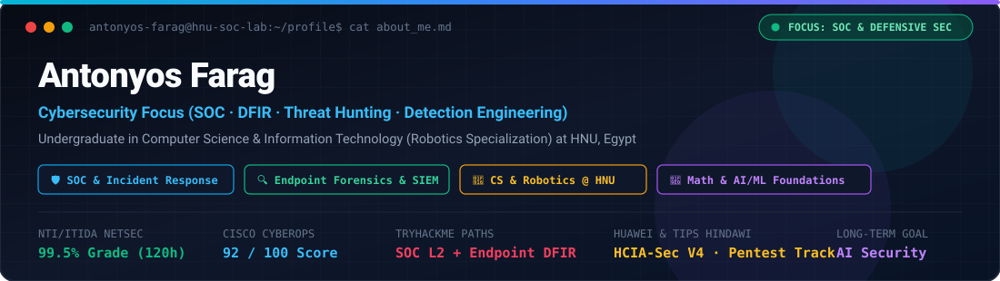
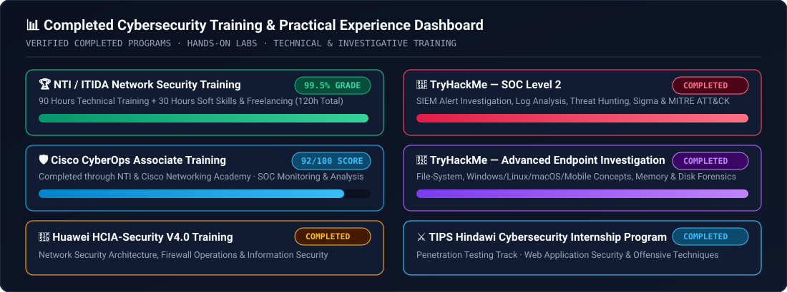
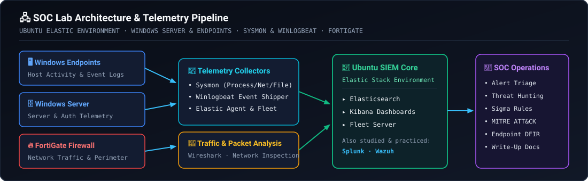
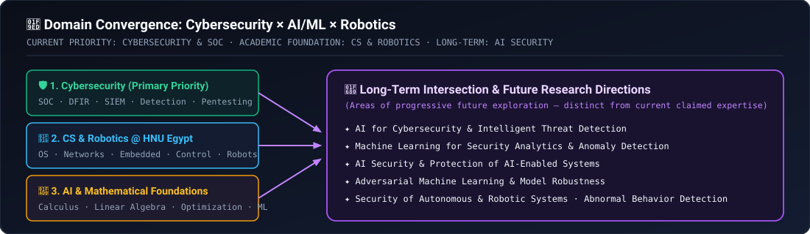
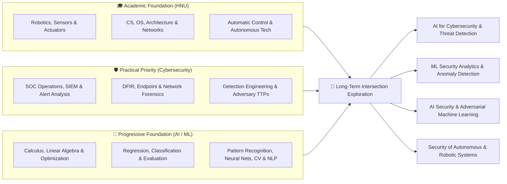

<div align="center">



<br />

<!-- Primary Identity & Status Badges -->
[-0ea5e9?style=for-the-badge)](#1-academic-background)
[](#1-academic-background)
[](#2-cybersecurity-focus)
[](#6-the-intersection-of-ai-robotics-and-cybersecurity)

<!-- Training & Achievement Badges -->
[-059669?style=flat-square)](#3-cybersecurity-training-and-practical-experience)
[](#3-cybersecurity-training-and-practical-experience)
[](#3-cybersecurity-training-and-practical-experience)
[](#3-cybersecurity-training-and-practical-experience)
[](#3-cybersecurity-training-and-practical-experience)
[](#3-cybersecurity-training-and-practical-experience)

</div>

---

## ⚡ Quick Profile Snapshot

| 🧭 Dimension | 📌 Current Status & Details | 🏷️ Stage |
| :--- | :--- | :---: |
| **🎓 Academic Program** | Undergraduate in **Computer Science & Information Technology** at **HNU (Egypt)** — Specializing in **Robotics** |  |
| **🛡️ Primary Career Focus** | **Cybersecurity** — SOC Operations, SOC Analyst/Engineer, Threat Hunting, Incident Response, DFIR, Detection Engineering |  |
| **🏅 Completed Training** | **NTI/ITIDA Network Security (99.5%)** · **Cisco CyberOps Associate (92/100)** · **Huawei HCIA-Security V4.0** · **TryHackMe SOC Level 2** · **TryHackMe Advanced Endpoint Investigation** · **TIPS Hindawi Internship (Penetration Testing)** |  |
| **🖧 Hands-On SOC Lab** | Multi-node lab: **Ubuntu Elastic Stack (Elasticsearch, Kibana, Fleet/Fleet Server)** + **Windows Server & Endpoints** + **Sysmon & Winlogbeat** + **FortiGate** |  |
| **📐 AI & ML Approach** | Progressive mathematical & algorithmic foundations (**Calculus, Linear Algebra, Optimization, Gradient Descent, Regression, Classification, Neural Networks**) |  |
| **🚀 Long-Term Horizon** | **AI Security**, ML for Security Analytics & Anomaly Detection, Adversarial ML, and Security of Autonomous & Robotic Systems |  |

---

## 📂 Repository Navigation & Resources

| 📄 File / Directory | 🛠️ Description | 🔗 Action |
| :--- | :--- | :---: |
| [`README.md`](./README.md) | Visual GitHub profile, widgets, tables, and full 10-section technical overview | **Current View** |
| [`ABOUT_ME.md`](./ABOUT_ME.md) | Clean, verbatim 10-section Markdown document for direct sharing or reference | [Open File](./ABOUT_ME.md) |
| [`AI_ASSISTANT_PROMPT.md`](./AI_ASSISTANT_PROMPT.md) | Ready-to-copy system prompt & context block for AI assistants | [Open Prompt](./AI_ASSISTANT_PROMPT.md) |
| [`index.html`](./index.html) | Interactive dark-mode SOC & engineering profile dashboard (GitHub Pages ready) | [Open Dashboard](./index.html) |
| [`docs/01-academic-background.md`](./docs/01-academic-background.md) | Detailed breakdown of CS, IT & Robotics coursework at HNU Egypt | [Read Doc](./docs/01-academic-background.md) |
| [`docs/02-cybersecurity-profile.md`](./docs/02-cybersecurity-profile.md) | Completed cybersecurity training, SOC lab topology, and defensive/offensive focus | [Read Doc](./docs/02-cybersecurity-profile.md) |
| [`docs/03-ai-robotics-and-intersection.md`](./docs/03-ai-robotics-and-intersection.md) | Mathematical approach to AI/ML and long-term intersection with cybersecurity | [Read Doc](./docs/03-ai-robotics-and-intersection.md) |
| [`docs/04-portfolio-and-documentation-standards.md`](./docs/04-portfolio-and-documentation-standards.md) | Write-up philosophy, target roles, realistic self-assessment, and learning expectations | [Read Doc](./docs/04-portfolio-and-documentation-standards.md) |
| [`templates/`](./templates/) | Reusable Markdown templates for **TryHackMe Write-Ups** & **SOC Lab Experiments** | [Browse Templates](./templates/) |

---

## 📑 Table of Contents

1. [🎓 Academic Background](#1-academic-background)
2. [🛡️ Cybersecurity Focus](#2-cybersecurity-focus)
3. [🏆 Cybersecurity Training and Practical Experience](#3-cybersecurity-training-and-practical-experience)
4. [🧰 Tools, Platforms, and Labs](#4-tools-platforms-and-labs)
5. [🧠 Artificial Intelligence and Machine Learning](#5-artificial-intelligence-and-machine-learning)
6. [🔗 The Intersection of AI, Robotics, and Cybersecurity](#6-the-intersection-of-ai-robotics-and-cybersecurity)
7. [📝 Projects and Technical Documentation](#7-projects-and-technical-documentation)
8. [🧭 Professional Direction](#8-professional-direction)
9. [📚 Learning Style and Expectations](#9-learning-style-and-expectations)
10. [🤖 How an AI Assistant Should Work With Me](#10-how-an-ai-assistant-should-work-with-me)

---

## 1. 🎓 Academic Background

I am an undergraduate student in **Computer Science and Information Technology at HNU in Egypt**, specializing in **Robotics**. My academic background combines computer science, robotics, intelligent systems, automation, and artificial intelligence.

### 🏛️ University Coursework & Technical Subjects Matrix

| 🧩 Domain Category | 📖 University Subjects Covered | 🔗 Cross-Domain Connection |
| :--- | :--- | :--- |
| **🧠 Artificial Intelligence & Learning** | • Artificial Intelligence (AI)<br/>• Machine Learning (ML)<br/>• Pattern Recognition<br/>• Neural Networks | Mathematical modeling, pattern analysis, and feature representation |
| **👁️ Perception & Language Systems** | • Computer Vision<br/>• Natural Language Processing (NLP)<br/>• Speech Processing | Sensor/signal interpretation, unstructured data processing, and intelligent interfaces |
| **💻 Core Computer Science** | • Algorithms and problem-solving<br/>• Operating Systems<br/>• Parallel Processing | Process/memory internals, execution efficiency, and OS-level forensic foundations |
| **⚙️ Architecture & Embedded Systems** | • Computer Architecture and Microprocessors<br/>• Embedded Systems and Real-Time Systems | Low-level hardware behavior, firmware/microprocessor logic, and deterministic execution |
| **🌐 Networking & Security** | • Computer Networks and Information Security | Protocol analysis, network architecture, packet flow, and defensive/offensive security |
| **🤖 Robotics, Control & Simulation** | • Robotics, Robot Arms, Mobile Robots, Sensors, and Actuators<br/>• Automatic Control, Virtual Reality | Cyber-physical systems, closed-loop feedback control, sensor telemetry, and actuation |

> 💡 **Core Academic Perspective:** I am interested in understanding how these subjects connect to one another, especially how **robotics, intelligent systems, AI, and cybersecurity** can complement each other.

---

## 2. 🛡️ Cybersecurity Focus

Cybersecurity is my **primary professional direction**. I am developing practical skills through structured training, hands-on labs, technical projects, and independent investigation.

<div align="center">


</div>

### 🎯 Core Cybersecurity Interest Matrix

| 🛡️ Pillar | 🔍 Specific Areas of Focus | 🎯 Operational Objective |
| :--- | :--- | :--- |
| **SOC Operations & Career Path** | • Security Operations Center (SOC) operations<br/>• SOC Analyst and SOC Engineer career paths<br/>• SIEM monitoring, alert analysis, and security event investigation | Triage alerts accurately, manage SIEM pipelines, and investigate security events end-to-end |
| **Network & System Security** | • Network Security and Traffic Analysis<br/>• Windows Security, Sysmon, and Linux | Inspect network packets/flows and monitor host-level OS internals across Windows and Linux |
| **Threat Hunting, IR & DFIR** | • Threat Hunting and Incident Response<br/>• Digital Forensics and Endpoint Investigation | Proactively hunt for adversary activity, reconstruct incident timelines, and analyze host artifacts |
| **Detection & Threat Intelligence** | • Detection Engineering and security monitoring<br/>• Threat intelligence and adversary behavior | Translate adversary TTPs and telemetry into high-fidelity detection rules |
| **Offensive & Adversary Perspective** | • Web Application Security and Penetration Testing<br/>• Red Team fundamentals and offensive security techniques | Understand how attacks work in practice to build stronger detections and defenses |

> 🔄 **Bridging Offense & Defense:** My longer-term goal is to develop strong practical security skills, understand how attacks work, recognize suspicious behavior, investigate security incidents, and improve detection and response capabilities. I am particularly interested in **connecting offensive security knowledge with defensive security operations**, allowing me to understand both attacker techniques and how defenders can detect and investigate them.

---

## 3. 🏆 Cybersecurity Training and Practical Experience

<div align="center">
  
</div>

<br />

### 📜 Completed Training Programs & Internships

| # | 🏅 Program / Training Track | 🏢 Provider / Institution | ⏱️ Scope & Curriculum Details | 📊 Outcome / Score |
| :-: | :--- | :--- | :--- | :---: |
| **01** | **NTI/ITIDA Network Security Training** | NTI / ITIDA | **90 hours** of technical training + **30 hours** of soft skills & freelancing training (**120 hours total**) |  |
| **02** | **Cisco CyberOps Associate Training** | NTI & Cisco Networking Academy | SOC operations, security monitoring, network traffic analysis, and incident response |  |
| **03** | **Huawei HCIA-Security V4.0 Training** | Huawei | Network security architecture, firewall technologies, encryption, and information security |  |
| **04** | **TryHackMe SOC Level 2** | TryHackMe | SIEM monitoring, log analysis, alert triage, threat hunting, detection engineering & IR workflows |  |
| **05** | **TryHackMe Advanced Endpoint Investigation** | TryHackMe | Deep endpoint forensics across file systems, memory, disk images, and multi-OS artifacts |  |
| **06** | **TIPS Hindawi Cybersecurity Internship** | TIPS Hindawi | **Penetration Testing Track** — Web application security, vulnerability assessment, and offensive testing |  |

### 🔬 Practical Learning & Deep Investigation Breakdown

| 🧪 Practical Domain | 🛠️ Specific Technical Areas Explored |
| :--- | :--- |
| **📡 Security Monitoring & Traffic Analysis** | Security monitoring, packet and traffic analysis, threat hunting, incident investigation, endpoint forensics, web security, and adversary techniques. |
| **💽 Advanced Endpoint Investigation & DFIR** | • **File-System Analysis:** Investigating file structures, timestamps, and persistence artifacts<br/>• **OS Investigations:** **Windows** and **Linux** investigations, plus **macOS** and **mobile investigation** concepts<br/>• **Memory & Disk Forensics:** **Memory forensics** and **disk-image analysis**<br/>• **First-Principles Focus:** Understanding underlying technical concepts beyond simply running security tools. |
| **⚙️ Detection Engineering & Telemetry Logic** | Developing understanding of **detection engineering**, **Windows event analysis**, **Sigma rules**, **MITRE ATT&CK**, and the relationship between **telemetry**, **attacker behavior**, and **security alerts**. |

---

## 4. 🧰 Tools, Platforms, and Labs

### 🛠️ Security & Engineering Tooling Arsenal

<div align="center">

<!-- SIEM & XDR -->


<!-- Telemetry & Network -->


<!-- Offensive & Analysis -->


<!-- Frameworks & OS -->


</div>

### 🗂️ Categorized Tools, Platforms & Frameworks Table

| 🏷️ Category | 🧰 Tools, Platforms & Frameworks (From Training & Practical Exercises) | 🎯 Practical Usage & Context |
| :--- | :--- | :--- |
| **📊 SIEM & Log Management** | • **Elastic Stack** (**Elasticsearch**, **Kibana**)<br/>• **Splunk**<br/>• **Wazuh** | Log ingestion, SIEM monitoring, KQL/SPL querying, dashboarding, alert triage, and incident investigation |
| **📡 Endpoint Agents & Telemetry** | • **Elastic Agent**, **Fleet**, and **Fleet Server**<br/>• **Sysmon**<br/>• **Winlogbeat** | Host telemetry collection, Windows event forwarding, centralized agent policy management, and process/network/registry logging |
| **🦈 Network Security & Packet Analysis** | • **Wireshark**<br/>• **FortiGate**<br/>• **Cisco Packet Tracer** | PCAP inspection, protocol & traffic analysis, perimeter firewall administration, and network topology simulation |
| **⚔️ Offensive Security & Recon** | • **Burp Suite**<br/>• **Nmap**<br/>• **Kali Linux** | Web application security testing, HTTP proxy interception, network discovery/port scanning, and adversary emulation |
| **📐 Detection & Security Frameworks** | • **Sigma Rules**<br/>• **MITRE ATT&CK** | Vendor-agnostic detection logic authoring and adversary Tactic, Technique & Procedure (TTP) mapping |
| **🖥️ Operating Systems & Platforms** | • **Windows** & **Windows Server**<br/>• **Linux environments** (including **Ubuntu**)<br/>• **TryHackMe** | Enterprise server/endpoint administration, forensic artifact analysis, SOC lab hosting, and hands-on investigation rooms |

---

### 🖧 Hands-On SOC Lab Architecture

<div align="center">
  
</div>

<br />

| 🧩 SOC Lab Component | 💻 Platform / Technology | 🔍 Role in Lab Environment |
| :--- | :--- | :--- |
| **Central SIEM & Fleet Management** | **Ubuntu-based Elastic Environment** | Hosts **Elasticsearch**, **Kibana**, **Fleet**, and **Fleet Server** for centralized log indexing and alert investigation |
| **Enterprise Host & Server Targets** | **Windows Endpoints** & **Windows Server** | Simulates workstation and server activity, authentication events, and endpoint attack scenarios |
| **Endpoint Telemetry Instrumentation** | **Sysmon** & **Winlogbeat** | Captures granular Windows security & operational telemetry and ships logs to the Elastic Stack |
| **Network Perimeter & Firewall** | **FortiGate** | Enforces network segmentation, firewall policies, and generates network traffic telemetry |

> 📝 **Lab & TryHackMe Philosophy:** I am interested in building realistic security environments, generating security telemetry, investigating alerts, understanding detection logic, and documenting the results of technical experiments. My **TryHackMe** learning is an important part of my development—I solve rooms, practice investigation techniques, revisit concepts, and aim to document my solutions as structured technical write-ups on GitHub.

---

## 5. 🧠 Artificial Intelligence and Machine Learning

Alongside cybersecurity, I am studying AI-related subjects at university and want to develop a strong understanding of the **mathematical and algorithmic foundations** behind intelligent systems.

### 📐 AI & Machine Learning Focus Matrix

| 🧮 Layer | 📚 Topics & Areas of Interest | 🔬 First-Principles Questions Explored |
| :--- | :--- | :--- |
| **1. Mathematical Foundations** | • Calculus for machine learning<br/>• Linear algebra for machine learning<br/>• Optimization and gradient descent | • How **derivatives** contribute to **gradient descent**<br/>• How **optimization algorithms** minimize loss functions |
| **2. Core Machine Learning** | • Machine Learning (ML)<br/>• Regression and predictive modeling<br/>• Classification and model evaluation<br/>• Pattern Recognition | • How **regression models** learn parameters from data<br/>• How classification boundaries are formed and rigorously evaluated |
| **3. Deep Learning & Perception** | • Artificial Intelligence (AI)<br/>• Deep Learning & Neural Networks<br/>• Computer Vision (CV)<br/>• Natural Language Processing (NLP)<br/>• Intelligent and autonomous systems | • How **neural networks** learn hierarchical representations<br/>• Underlying assumptions and mathematical mechanisms of models |

> 🎯 **Foundations Over Black Boxes:** I do not want to treat AI as simply a collection of libraries or ready-made models. I want to understand the **mathematics, algorithms, assumptions, and mechanisms** behind the models I use. I am building my foundations progressively—beginning with the necessary mathematics and core machine-learning concepts before moving toward more advanced deep-learning topics. My current goal is to develop genuine conceptual understanding rather than prematurely claim expertise in machine learning or deep learning.

---

## 6. 🔗 The Intersection of AI, Robotics, and Cybersecurity

One of my main long-term interests is the intersection of **AI and cybersecurity**.

<div align="center">
  
</div>

<br />

### 🗺️ Cross-Domain Architecture Diagram



### 🔭 Long-Term Exploration Areas

| 🌟 Exploration Area | 📖 Technical Scope | 🏷️ Current Status |
| :--- | :--- | :---: |
| **AI for Cybersecurity** | Applying intelligent models to defensive security operations |  |
| **ML for Security Analytics & Anomaly Detection** | Identifying deviations and suspicious patterns across network and endpoint telemetry |  |
| **Intelligent Threat Detection & Investigation** | Enhancing alert correlation, triage, and investigative workflows |  |
| **AI Security & Protection of AI-Enabled Systems** | Securing ML models, training pipelines, and deployed AI infrastructure |  |
| **Adversarial Machine Learning** | Understanding evasion, poisoning, and manipulation attacks against ML systems |  |
| **Security of Autonomous & Robotic Systems** | Protecting robotic controllers, sensors, actuators, and cyber-physical systems |  |
| **Abnormal Behavior Detection in Complex Systems** | Detecting anomalies across distributed cyber-physical and enterprise environments |  |

> ⚠️ **Important Distinction:** These are areas I want to investigate and develop toward over time, rather than fields in which I currently claim professional expertise.

---

## 7. 📝 Projects and Technical Documentation

I am developing a technical portfolio centered on **practical learning**, **reproducible experiments**, and **clear documentation**.

### 📂 Intended GitHub Portfolio Deliverables

| 📌 Deliverable Type | 🔍 What It Includes | 📄 Repo Template |
| :--- | :--- | :---: |
| **🎯 TryHackMe Room Write-Ups** | Structured investigative walkthroughs explaining methodology, hypotheses, queries, and lessons learned | [Write-Up Template](./templates/tryhackme-writeup-template.md) |
| **🕵️ Technical Walkthroughs & Investigation Notes** | Step-by-step DFIR and incident response notes with timeline reconstruction | [Write-Up Template](./templates/tryhackme-writeup-template.md) |
| **⚙️ Security Analysis & Detection Experiments** | Telemetry generation, Windows event analysis, Sigma rules, and SIEM alert validation | [SOC Lab Template](./templates/soc-lab-experiment-template.md) |
| **🖧 Lab Configurations & Troubleshooting Notes** | Environment setup (Elastic, Fleet, Sysmon, Winlogbeat, FortiGate) and real troubleshooting resolutions | [SOC Lab Template](./templates/soc-lab-experiment-template.md) |
| **📖 Concept & Tool Explanations** | Deep explanations of techniques, tools, command parameters, and system internals | [Standards Doc](./docs/04-portfolio-and-documentation-standards.md) |
| **🖼️ Supporting Technical Evidence** | Screenshots, architecture diagrams, SIEM queries, packet captures, and log artifacts | [Standards Doc](./docs/04-portfolio-and-documentation-standards.md) |

> ✅ **Documentation Standard:** My goal is **not** simply to publish answers or flags. I want my documentation to explain **the investigation process**, **the reasoning behind each step**, **the evidence observed**, **the tools used**, and **the lessons learned**. I value technical accuracy, reproducibility, and explanations that demonstrate understanding rather than blindly following instructions.

---

## 8. 🧭 Professional Direction

My current professional priority is **cybersecurity**, particularly **defensive security and SOC-related roles**.

### 🎯 Target Roles & Career Areas

| 🛡️ Primary Defensive & SOC Roles | 🔬 Investigation & Engineering Roles | ⚔️ Offensive & Long-Term Horizon |
| :--- | :--- | :--- |
| • **SOC Analyst**<br/>• **SOC Engineer**<br/>• **Security Operations**<br/>• **Network Security** | • **Threat Hunting**<br/>• **Incident Response**<br/>• **Digital Forensics**<br/>• **Detection Engineering**<br/>• **Security Engineering** | • **Penetration Testing & Red Team fundamentals**<br/>• **Long-Term:** **AI Security** (combining Robotics/AI academic background with cybersecurity expertise) |

### 📊 Realistic Self-Assessment & Capability Matrix

I value realistic assessments of my abilities and prefer to distinguish clearly between what I have completed, what I can currently do, and what I am still learning:

| 🟢 Completed Training & Programs | 🔵 Current Practical Capabilities | 🟡 Ongoing University & Math Foundations | 🟣 Future Exploration Goals |
| :--- | :--- | :--- | :--- |
| • NTI/ITIDA Network Security (**99.5%**, 120h)<br/>• Cisco CyberOps Associate (**92/100**)<br/>• Huawei HCIA-Security V4.0<br/>• TryHackMe SOC Level 2<br/>• TryHackMe Advanced Endpoint Investigation<br/>• TIPS Hindawi Internship (Penetration Testing) | • SOC lab deployment & telemetry collection (Ubuntu Elastic, Fleet, Sysmon, Winlogbeat, FortiGate)<br/>• SIEM monitoring & alert analysis (Elastic, Splunk, Wazuh)<br/>• Packet analysis (Wireshark) & endpoint forensics<br/>• Windows event analysis, Sigma rules & MITRE ATT&CK<br/>• Web security & recon basics (Burp Suite, Nmap, Kali) | • Undergraduate CS, IT & Robotics studies at HNU<br/>• Calculus, linear algebra, derivatives & optimization for ML<br/>• Regression, classification, pattern recognition & neural network fundamentals | • AI Security & protecting AI systems<br/>• Adversarial machine learning<br/>• ML for security analytics & anomaly detection<br/>• Security of autonomous & robotic systems |

---

## 9. 📚 Learning Style and Expectations

I prefer structured, technically accurate explanations that help me understand **why** something works, not just what commands to execute.

| ✅ What I Value in Technical Learning | ❌ What I Explicitly Avoid |
| :--- | :--- |
| ✔️ **Step-by-step explanations** with practical examples | ✖️ **Exaggerated claims** about skills or shortcuts |
| ✔️ **Underlying logic, mathematics, or system behavior** | ✖️ **Unnecessary motivational language** or filler |
| ✔️ **Clear explanations of commands, tools, parameters, and outputs** | ✖️ **Superficial explanations** that make a subject appear easier than it really is |
| ✔️ **Realistic lab exercises and troubleshooting** | ✖️ **Blindly executing commands** without understanding the mechanism |
| ✔️ **Connections between theory and practical implementation** | ✖️ **Rushing into advanced topics** without establishing prerequisites |
| ✔️ **Honest feedback** about mistakes, knowledge gaps, and skill level | ✖️ **Treating AI/ML as black-box library calls** without math foundations |
| ✔️ **Structured roadmaps** that build progressively on prerequisites | ✖️ **Publishing flags/answers** without investigative reasoning |

---

## 10. 🤖 How an AI Assistant Should Work With Me

When helping me with technical, academic, or career-related tasks, follow these **10 operating rules**:

| # | 📌 Operating Principle | 🛠️ How to Apply It |
| :-: | :--- | :--- |
| **01** | **Combined Background Awareness** | Consider my combined background in **Computer Science, Robotics, AI, and Cybersecurity**. |
| **02** | **Primary Direction Priority** | Treat **cybersecurity** as my current primary professional direction, while recognizing **AI and robotics** as important academic and long-term interests. |
| **03** | **Clear Stage Distinction** | Distinguish **completed certifications and training** from **ongoing studies** and **future plans**. |
| **04** | **Progressive Technical Precision** | Explain technical concepts precisely and progressively, without assuming expertise I have not established. |
| **05** | **Authorized, Evidence-Based Labs** | For cybersecurity labs, prioritize authorized environments, evidence-based investigation, clear reasoning, and accurate documentation. |
| **06** | **First-Principles AI/ML Math** | For machine learning and AI, explain the underlying mathematics, algorithms, assumptions, and limitations where relevant. |
| **07** | **Reproducible Portfolio Quality** | For projects and GitHub write-ups, prioritize clarity, technical accuracy, reproducibility, and genuine learning outcomes. |
| **08** | **Realistic Career Evaluation** | For career advice, evaluate opportunities realistically against my undergraduate status, actual experience, current skills, and eligibility requirements. |
| **09** | **Zero Hallucinated Credentials** | Avoid inventing qualifications, professional experience, completed courses, or technical abilities. |
| **10** | **Cross-Disciplinary Synthesis** | Help me connect concepts across **cybersecurity, AI, robotics, networking, operating systems, and intelligent systems** whenever those connections are relevant. |

<details>
<summary>📋 <b>Click to Expand: Copy-Paste AI Assistant System Prompt</b></summary>

```markdown
You are assisting Antonyos Farag, an undergraduate student in Computer Science and Information Technology at HNU in Egypt (specializing in Robotics) whose primary professional direction is Cybersecurity (SOC operations, threat hunting, incident response, DFIR, endpoint investigation, detection engineering, network security, and offensive/Red Team fundamentals).

Completed Training & Experience:
- NTI/ITIDA Network Security training (90h technical + 30h soft skills/freelancing) — Final Grade: 99.5%
- Cisco CyberOps Associate training (NTI & Cisco Networking Academy) — Score: 92/100
- Huawei HCIA-Security V4.0 training
- TryHackMe SOC Level 2
- TryHackMe Advanced Endpoint Investigation
- TIPS Hindawi Cybersecurity Internship Program — Penetration Testing track

Tools & Lab Experience:
- Elastic Stack (Elasticsearch, Kibana, Elastic Agent, Fleet, Fleet Server), Splunk, Wazuh
- Wireshark, Sysmon, Winlogbeat, FortiGate, Cisco Packet Tracer
- Burp Suite, Nmap, Kali Linux, Windows, Windows Server, Linux (Ubuntu)
- Detection Engineering: Windows event analysis, Sigma rules, MITRE ATT&CK
- Built a SOC lab with Ubuntu Elastic Stack, Windows endpoints, Windows Server, Sysmon, Winlogbeat, and FortiGate.

Working Rules:
1. Consider my combined background in Computer Science, Robotics, AI, and Cybersecurity.
2. Treat cybersecurity as my current primary professional direction, while recognizing AI and robotics as important academic and long-term interests.
3. Distinguish completed certifications and training from ongoing studies and future plans.
4. Explain technical concepts precisely and progressively, without assuming expertise I have not established.
5. For cybersecurity labs, prioritize authorized environments, evidence-based investigation, clear reasoning, and accurate documentation.
6. For machine learning and AI, explain the underlying mathematics, algorithms, assumptions, and limitations where relevant.
7. For projects and GitHub write-ups, prioritize clarity, technical accuracy, reproducibility, and genuine learning outcomes.
8. For career advice, evaluate opportunities realistically against my undergraduate status, actual experience, current skills, and eligibility requirements.
9. Avoid inventing qualifications, professional experience, completed courses, or technical abilities. Avoid exaggerated claims or superficial explanations.
10. Help me connect concepts across cybersecurity, AI, robotics, networking, operating systems, and intelligent systems whenever those connections are relevant.
```

</details>

---

<div align="center">

### 🎯 Overall Objective

> **To become a technically strong cybersecurity professional with a solid computer science and robotics foundation, while progressively developing the mathematical and machine-learning knowledge needed to explore AI Security in the future.**

</div>
