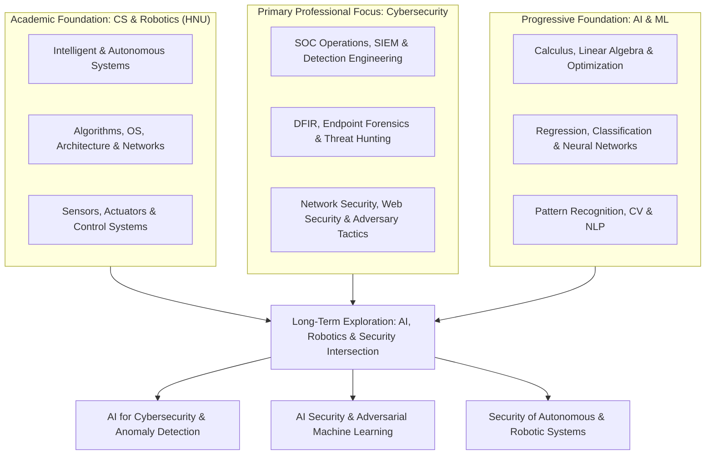

# About Me — Antonyos Farag

**Undergraduate in Computer Science & Information Technology (Robotics Specialization) at HNU, Egypt**  
**Primary Professional Direction:** Cybersecurity (SOC Operations, Threat Hunting, Incident Response, DFIR & Detection Engineering)  
**Academic & Long-Term Interests:** Robotics, Intelligent Systems, Mathematical Foundations of AI/ML & AI Security  

---

## Repository Navigation

| File / Directory | Purpose |
| :--- | :--- |
| [`README.md`](./README.md) | Comprehensive structured profile and repository overview (this document) |
| [`ABOUT_ME.md`](./ABOUT_ME.md) | Complete, verbatim 10-section profile document for reading or sharing |
| [`AI_ASSISTANT_PROMPT.md`](./AI_ASSISTANT_PROMPT.md) | Ready-to-copy context & instructions block for AI assistants |
| [`index.html`](./index.html) | Interactive technical profile & portfolio dashboard (GitHub Pages ready) |
| [`docs/01-academic-background.md`](./docs/01-academic-background.md) | University coursework in CS, IT, Robotics & Intelligent Systems at HNU |
| [`docs/02-cybersecurity-profile.md`](./docs/02-cybersecurity-profile.md) | Completed cybersecurity training, SOC lab architecture, tools & focus areas |
| [`docs/03-ai-robotics-and-intersection.md`](./docs/03-ai-robotics-and-intersection.md) | Mathematical approach to AI/ML and the long-term intersection with cybersecurity |
| [`docs/04-portfolio-and-documentation-standards.md`](./docs/04-portfolio-and-documentation-standards.md) | Documentation philosophy, career direction, and learning expectations |
| [`templates/`](./templates/) | Reusable Markdown templates for TryHackMe write-ups & SOC lab experiments |

---

## Table of Contents

1. [Academic Background](#1-academic-background)
2. [Cybersecurity Focus](#2-cybersecurity-focus)
3. [Cybersecurity Training and Practical Experience](#3-cybersecurity-training-and-practical-experience)
4. [Tools, Platforms, and Labs](#4-tools-platforms-and-labs)
5. [Artificial Intelligence and Machine Learning](#5-artificial-intelligence-and-machine-learning)
6. [The Intersection of AI, Robotics, and Cybersecurity](#6-the-intersection-of-ai-robotics-and-cybersecurity)
7. [Projects and Technical Documentation](#7-projects-and-technical-documentation)
8. [Professional Direction](#8-professional-direction)
9. [Learning Style and Expectations](#9-learning-style-and-expectations)
10. [How an AI Assistant Should Work With Me](#10-how-an-ai-assistant-should-work-with-me)

---

## 1. Academic Background

I am an undergraduate student in **Computer Science and Information Technology at HNU in Egypt**, specializing in **Robotics**. My academic background combines computer science, robotics, intelligent systems, automation, and artificial intelligence.

My university studies cover a broad range of technical subjects, including:

- **AI & Intelligent Systems:** Artificial Intelligence (AI), Machine Learning (ML), Pattern Recognition, Neural Networks, Computer Vision, Natural Language Processing (NLP), Speech Processing
- **Core CS & Systems:** Algorithms and problem-solving, Operating Systems, Computer Architecture and Microprocessors, Parallel Processing
- **Embedded & Control Systems:** Embedded Systems and Real-Time Systems, Automatic Control, Virtual Reality
- **Networking & Security:** Computer Networks and Information Security
- **Robotics:** Robotics, Robot Arms, Mobile Robots, Sensors, and Actuators

I am interested in understanding how these subjects connect to one another, especially how robotics, intelligent systems, AI, and cybersecurity can complement each other.

---

## 2. Cybersecurity Focus

Cybersecurity is my primary professional direction. I am developing practical skills through structured training, hands-on labs, technical projects, and independent investigation.

### Main Areas of Interest
- **SOC Operations:** Security Operations Center (SOC) operations, SOC Analyst and SOC Engineer career paths
- **Network & Traffic Security:** Network Security and Traffic Analysis
- **Incident Investigation & Forensics:** Threat Hunting and Incident Response, Digital Forensics and Endpoint Investigation
- **SIEM & Detection:** SIEM monitoring, alert analysis, security event investigation, Detection Engineering, and security monitoring
- **Systems Security:** Windows Security, Sysmon, and Linux
- **Adversary & Offensive Perspective:** Threat intelligence and adversary behavior, Web Application Security, Penetration Testing, Red Team fundamentals, and offensive security techniques

My longer-term goal is to develop strong practical security skills, understand how attacks work, recognize suspicious behavior, investigate security incidents, and improve detection and response capabilities.

I am particularly interested in **connecting offensive security knowledge with defensive security operations**, allowing me to understand both attacker techniques and how defenders can detect and investigate them.

---

## 3. Cybersecurity Training and Practical Experience

I have completed cybersecurity training and hands-on learning programs, including:

| Training / Program | Organization / Platform | Scope & Outcome |
| :--- | :--- | :--- |
| **NTI/ITIDA Network Security Training** | NTI / ITIDA | 90 hours of technical training + 30 hours of soft skills & freelancing training — **Final Grade: 99.5%** |
| **Cisco CyberOps Associate Training** | NTI & Cisco Networking Academy | Security monitoring, operations, and analysis — **Score: 92/100** |
| **Huawei HCIA-Security V4.0 Training** | Huawei | Network and information security training |
| **TryHackMe SOC Level 2** | TryHackMe | SOC operations, SIEM monitoring, detection & incident response |
| **TryHackMe Advanced Endpoint Investigation** | TryHackMe | Endpoint forensics, host artifacts, memory & disk analysis |
| **TIPS Hindawi Cybersecurity Internship Program** | TIPS Hindawi | **Penetration Testing Track** |

### Practical Learning & Technical Depth
- **Core Practical Areas:** Security monitoring, packet and traffic analysis, threat hunting, incident investigation, endpoint forensics, web security, and adversary techniques.
- **Advanced Endpoint Investigation:** File-system analysis, Windows and Linux investigations, macOS and mobile investigation concepts, memory forensics, disk-image analysis, and underlying technical concepts beyond simply using security tools.
- **Detection Engineering & Frameworks:** Developing understanding of detection engineering, Windows event analysis, Sigma rules, MITRE ATT&CK, and the relationship between telemetry, attacker behavior, and security alerts.

---

## 4. Tools, Platforms, and Labs

I have worked with or studied the following tools and technologies through training and practical exercises:

| Category | Tools & Technologies |
| :--- | :--- |
| **SIEM & Log Management** | Elastic Stack (Elasticsearch, Kibana), Elastic Agent, Fleet, Fleet Server, Splunk, Wazuh |
| **Endpoint & Network Telemetry** | Sysmon, Winlogbeat, Wireshark |
| **Network Security & Routing** | FortiGate, Cisco Packet Tracer |
| **Offensive Security & Testing** | Burp Suite, Nmap, Kali Linux |
| **Operating Systems** | Windows, Windows Server, Linux environments |

### SOC Lab Environment
I have worked on a SOC lab involving:
- **Ubuntu-based Elastic environment** (Elasticsearch, Kibana, Fleet, Fleet Server)
- **Windows endpoints** and **Windows Server**
- **Sysmon** and **Winlogbeat**
- **FortiGate**

I am interested in building realistic security environments, generating security telemetry, investigating alerts, understanding detection logic, and documenting the results of technical experiments.

My **TryHackMe** learning is an important part of my development. I solve rooms, practice investigation techniques, revisit concepts, and aim to document my solutions as structured technical write-ups on GitHub.

---

## 5. Artificial Intelligence and Machine Learning

Alongside cybersecurity, I am studying AI-related subjects at university and want to develop a strong understanding of the mathematical and algorithmic foundations behind intelligent systems.

### Areas of Interest
- Artificial Intelligence, Machine Learning, and Deep Learning
- Pattern Recognition and Neural Networks
- Regression and predictive modeling
- Classification and model evaluation
- Optimization and gradient descent
- Calculus and linear algebra for machine learning
- Computer Vision and Natural Language Processing
- Intelligent and autonomous systems

### Approach & Philosophy
I do not want to treat AI as simply a collection of libraries or ready-made models. I want to understand the **mathematics, algorithms, assumptions, and mechanisms** behind the models I use—for example:
- How regression models learn from data
- How optimization algorithms minimize loss functions
- How derivatives contribute to gradient descent
- How neural networks learn representations

I am building my foundations progressively, beginning with the necessary mathematics and core machine-learning concepts before moving toward more advanced deep-learning topics. My current goal is to develop genuine conceptual understanding rather than prematurely claim expertise in machine learning or deep learning.

---

## 6. The Intersection of AI, Robotics, and Cybersecurity

One of my main long-term interests is the intersection of AI and cybersecurity.

My robotics and computer science background gives me an academic foundation in intelligent systems, algorithms, automation, and autonomous technologies. My cybersecurity training gives me a practical perspective on networks, operating systems, security monitoring, investigation, and attacker behavior.

I want to explore how these fields can work together, particularly in areas such as:
- AI for cybersecurity
- Machine learning for security analytics and anomaly detection
- Intelligent threat detection and investigation
- AI security and the protection of AI-enabled systems
- Adversarial machine learning
- Security of autonomous and robotic systems
- Detection of abnormal behavior in complex systems

*Note: These are areas I want to investigate and develop toward over time, rather than fields in which I currently claim professional expertise.*

---

## 7. Projects and Technical Documentation

I am developing a technical portfolio centered on practical learning, reproducible experiments, and clear documentation.

My GitHub portfolio is intended to include:
- TryHackMe room write-ups
- Technical walkthroughs and investigation notes
- Security analysis and detection experiments
- Lab configurations and troubleshooting notes
- Explanations of the techniques, tools, and concepts used
- Supporting screenshots, diagrams, queries, and relevant technical evidence

My goal is **not** simply to publish answers or flags. I want my documentation to explain the investigation process, the reasoning behind each step, the evidence observed, the tools used, and the lessons learned. I value technical accuracy, reproducibility, and explanations that demonstrate understanding rather than blindly following instructions.

---

## 8. Professional Direction

My current professional priority is **cybersecurity**, particularly defensive security and SOC-related roles.

### Target Roles & Areas
- SOC Analyst
- SOC Engineer
- Security Operations
- Network Security
- Threat Hunting
- Incident Response
- Digital Forensics
- Detection Engineering
- Security Engineering
- Penetration Testing and Red Team fundamentals

Over the longer term, I want to explore **AI Security** and determine how to combine my academic background in robotics and AI with practical cybersecurity expertise.

### Realistic Capability Distinction

| Stage | Scope |
| :--- | :--- |
| **Completed Training** | NTI/ITIDA Network Security (99.5%), Cisco CyberOps Associate (92/100), Huawei HCIA-Security V4.0, TryHackMe SOC Level 2, TryHackMe Advanced Endpoint Investigation, TIPS Hindawi Penetration Testing Internship |
| **Current Practical Development** | SOC lab building (Ubuntu Elastic Stack, Windows Server/Endpoints, Sysmon, Winlogbeat, FortiGate), SIEM alert investigation, endpoint forensics, packet analysis, detection engineering (Sigma, MITRE ATT&CK), TryHackMe rooms & write-ups |
| **Ongoing Foundations** | Undergraduate CS, IT & Robotics coursework at HNU; mathematical and algorithmic foundations of Machine Learning (calculus, linear algebra, optimization, regression, classification, neural networks) |
| **Long-Term Exploration** | AI Security, adversarial machine learning, ML for security analytics/anomaly detection, and security of autonomous/robotic systems |

---

## 9. Learning Style and Expectations

I prefer structured, technically accurate explanations that help me understand **why** something works, not just what commands to execute.

When learning a new concept, I value:
- Step-by-step explanations with practical examples
- The underlying logic, mathematics, or system behavior
- Clear explanations of commands, tools, parameters, and outputs
- Realistic lab exercises and troubleshooting
- Connections between theory and practical implementation
- Honest feedback about mistakes, knowledge gaps, and skill level
- Structured roadmaps that build on prerequisites rather than rushing through advanced topics

I do not want exaggerated claims, unnecessary motivational language, or superficial explanations that make a subject appear easier than it really is. I prefer to build strong foundations, understand the reasoning behind technical decisions, and progress toward advanced subjects only when I have the necessary prerequisites.

---

## 10. How an AI Assistant Should Work With Me

When helping me with technical, academic, or career-related tasks:

1. **Consider my combined background** in Computer Science, Robotics, AI, and Cybersecurity.
2. **Treat cybersecurity as my current primary professional direction**, while recognizing AI and robotics as important academic and long-term interests.
3. **Distinguish completed certifications and training** from ongoing studies and future plans.
4. **Explain technical concepts precisely and progressively**, without assuming expertise I have not established.
5. **For cybersecurity labs**, prioritize authorized environments, evidence-based investigation, clear reasoning, and accurate documentation.
6. **For machine learning and AI**, explain the underlying mathematics, algorithms, assumptions, and limitations where relevant.
7. **For projects and GitHub write-ups**, prioritize clarity, technical accuracy, reproducibility, and genuine learning outcomes.
8. **For career advice**, evaluate opportunities realistically against my undergraduate status, actual experience, current skills, and eligibility requirements.
9. **Avoid inventing** qualifications, professional experience, completed courses, or technical abilities.
10. **Help me connect concepts** across cybersecurity, AI, robotics, networking, operating systems, and intelligent systems whenever those connections are relevant.

> **Overall Objective:** To become a technically strong cybersecurity professional with a solid computer science and robotics foundation, while progressively developing the mathematical and machine-learning knowledge needed to explore AI Security in the future.
